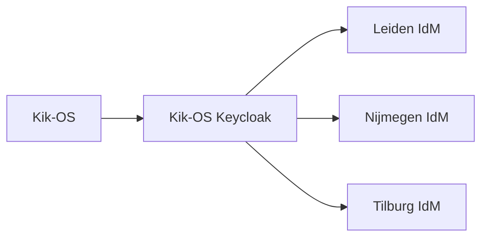

# ADR-001: IdM architecture

**Status:** in review

For Prompt on the Job use of Oauth2 is mandatory for all users. This
architecture design record describes the required Identity Management (IdM)
configuration.

# Requirements

- *Must* allow users to use their existing work account.
- *Must* allow a municipality must be able to configure roles for its own users.
- *Should* support [OAuth2 Dynamic Client
  Registration](https://oauth.net/2/dynamic-client-registration/) (DCR) to allow
  users to setup new agents and use the MCP server.

# Assumptions

- Every municipality has its own identity management system. These system
  support OAuth2 Identity Management (IdM)
- Changes in identity management configuration (user roles, attributes, etc.)
  are difficult to make. This typically requires a long review process and can
  only be done by system administrators.
- Not all municipal IdM servers support DCR.

# IdM configuration

We will deploy a single Keycloak instance and link Kik-OS to that. In Keycloak a
separate realm is configured for each municipality to allow users from that
municipality to access the Prompt on the Job platform.

To determine which municipality a user belongs to Kik-OS a hardcoded `gemeente`
claim is added to the realm configuration in the PotJ Keycloak instance.
Technically the issuer (`iss`) claim can also be used, however this exposes
internal details from the municipality such as the base URL of their current IdM
(for example `https://login.microsoftonline.com/1947194712`) and is less human
friendly.

This architecture isolates Kik-OS from the idiosyncrasies of different IdM
implementation which will reduce the implementation and maintenance effort. It
also guarantees DCR is supported for all users and keeps authentication
complexity out of Kik-OS.

# Role / permission management

User roles are configured in Kik-OS, not via OAuth claims. This allows us to provide
a rich experience for role management directly in Kik-OS without requiring coordination
with system administrators for each municipality.